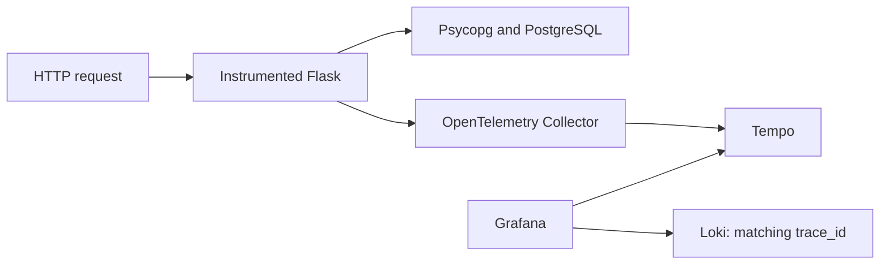

# Following a request

English · [Português](README.md)

Metrics reveal a change, logs help investigate it, and traces show the steps inside a request. This lab instruments the notes application with OpenTelemetry for Flask and Psycopg, sending spans through a Collector to Tempo.

The same application keeps two replicas on Kubernetes. The existing Grafana gets a **Notes Tempo** datasource, linked to Loki logs through the same `trace_id`.



## Current API: Alpine, including OpenTelemetry

The main labs now use the released Alpine digests: basic API for Docker/basic Kubernetes and instrumented API for the GitOps tracing workload. Backups were restored separately and actual image rollback preserved notes written after cutover. Database images, credentials and volumes stay in place. [Adoption, tested rollback and complete evidence](https://github.com/tommmdl/security-lab/blob/main/docs/api-adoption.en.md). Retained Debian findings remain visible.

## Prepare the environment

Clone beside [kubernetes-lab](https://github.com/tommmdl/kubernetes-lab), [monitoring-lab](https://github.com/tommmdl/monitoring-lab) and [logging-lab](https://github.com/tommmdl/logging-lab). Use Linux x86_64 or WSL with Docker, Git, Bash, Python 3 and internet access.

For a new environment, follow those projects' READMEs to create `devops-notes`, the application, Grafana and Loki collection. Skip setup if they are healthy. Avoid reapplying application manifests after Argo CD takes over. Export `KUBERNETES_LAB_DIR` if Kubernetes lab is elsewhere.

Here:

```bash
bash scripts/build.sh
bash scripts/lab.sh up
```

The image adds tracing dependencies and an initialization module to the existing docker-lab image pinned by digest. Routes and database access remain upstream. Complete Python dependencies are locked in `instrumentation/requirements.lock`. The SDK starts inside each Gunicorn worker, without `--preload`.

The image tag derives from instrumentation source files and is loaded into both kind nodes. **It is not published to a registry.** `imagePullPolicy: Never` requires building and loading it before deployment. The script uses BuildKit. If WSL lacks Buildx, it downloads a fixed version under `.local/` and checks the official checksum. This avoids an image export problem encountered with Docker's legacy builder.

## Apply instrumentation

With Argo CD, desired state lives in [argocd-lab/workloads/notes-traced](https://github.com/tommmdl/argocd-lab/tree/main/workloads/notes-traced). Match the image in `config/app-image.json` and the OTEL variables in `application/patch.yaml`. Change that repository through Git. Select this option with `bash scripts/argocd.sh apply` and wait for **Synced / Healthy**, keeping self-heal enabled. The Application definition is versioned in `application/argocd.yaml`; the basic option remains in `workloads/notes`.

In a disposable cluster without Argo CD, such as CI:

```bash
bash scripts/app.sh
```

That script refuses to patch when it finds Application `notes`, avoiding competition over its Deployment.

Then run:

```bash
python3 tests/verify.py
```

Tests use temporary port-forwards. The application remains at http://localhost:8005.

## Find a trace

Open Grafana at http://localhost:8008. Run `bash scripts/access.sh grafana` if its tunnel needs reopening. Keep the existing monitoring-lab credentials.

In **Explore**, select **Notes Tempo**. Send a request:

```bash
curl -i http://localhost:8005/notes
```

Copy response header `X-Trace-Id` and search that ID in Tempo. The trace contains an HTTP server span and PostgreSQL client spans, linked through parent/child relationships. Database spans measure work observed by the driver; the PostgreSQL server process itself is not instrumented.

You can also search with TraceQL:

```traceql
{ resource.service.name = "notes-api" }
```

The module writes one JSON line to stdout with trace ID, span ID, method, route and status. logging-lab's Alloy collects it normally. The traces-to-logs link uses `app` and `namespace` labels and filters log text by trace ID, rather than making request IDs into labels.

`/healthz` and `/readyz` are excluded from traces to reduce probe noise. Their existing access logs and monitoring signals remain available. A 404 appears as an HTTP span attribute; it does not necessarily mark a server span as ERROR.

## What the test follows

The test sends a known `traceparent`, checks the response ID and waits for a real trace to arrive through Collector. It verifies the Flask span, caller parent propagation and Psycopg SELECT spans. It creates and deletes only its own test note and checks that the note title is absent from trace data.

It then queries the trace through Grafana and finds the same ID in Loki logs. Existing Prometheus and Loki datasources are checked too. It does not push synthetic spans directly to Tempo.

See [results and limits](docs/validation.en.md).

**19 checks passed locally and in GitHub Actions.**

## Storage and limits

Tempo v3.1.0 runs in monolithic mode with filesystem storage and a 2 GiB PVC. Collector v0.163.1 receives OTLP HTTP and forwards batches to Tempo. Official images are pinned by digest in `config/images.json`. Collector needs no Kubernetes API permissions.

Block retention is set to 24 hours. Deletion is asynchronous and has not been validated by waiting a whole day; it is not a disk quota. Collector queues are in memory without durable storage. There is no lossless delivery or high availability guarantee, and no Kafka, object storage, span metrics or service graph configured.

Sampling uses `parentbased_always_on`: requests without a parent are sampled, while an existing parent's decision not to sample is respected. This makes exercises convenient; it is not a production volume policy.

The SDK does not capture request bodies or arbitrary headers. SQL instrumentation can contain statement text and database metadata. The test checks one parameterized note title, not universal sensitive-data masking. Avoid personal data and tokens.

Tempo and Collector are ClusterIP services without authentication/TLS on this local network. Do not expose them directly to the internet. For local Tempo diagnostics, run `bash scripts/access.sh tempo` and open http://localhost:8010/ready.

## Remove tracing after restoring the app

First run `bash scripts/argocd.sh restore` to select the basic manifests in argocd-lab Git, then wait for a healthy app. Without Argo CD, restore the original Kubernetes lab Deployment. Then:

```bash
bash scripts/lab.sh down
```

The script refuses removal while the app uses the instrumented image. It removes only Notes Tempo and namespace tracing-lab, deleting its volume and traces. Grafana, Loki, Prometheus and application data remain in their own namespaces. `.local/` stays outside Git.

Setup and verification were carried out with assistant help. References: [Python instrumentation](https://opentelemetry.io/docs/languages/python/instrumentation/), [Psycopg instrumentation](https://opentelemetry-python-contrib.readthedocs.io/en/latest/instrumentation/psycopg/psycopg.html) and [monolithic Tempo](https://grafana.com/docs/tempo/latest/set-up-for-tracing/setup-tempo/deploy/locally/linux/).

The runtime image now inherits the API security fixes. OpenTelemetry dependencies are installed in a separate build stage and copied into the final image, which keeps no pip or ensurepip. Flask is pinned to 3.1.3 here too. See the [complete remediation reports](https://github.com/tommmdl/security-lab/blob/main/docs/remediation.en.md); remaining vulnerabilities are still reported and blocked by the security policy.

Remediation validation: 23 Compose checks, a controlled restore of three notes from the original PostgreSQL image into the rebuilt image, and 19 local tracing checks. The running Argo CD application is Synced/Healthy and retains the same PVC. Full evidence and remaining issues are linked above.

The corrected images also passed [all 19 tracing checks in CI](https://github.com/tommmdl/tracing-lab/actions/runs/39174296321); see `evidence/remediation-ci-tests.json`.

After the PostgreSQL critical review, the API uses an ordinary SQL role and the database image no longer includes SQLite. The application remains healthy; 24 Kubernetes and 19 tracing checks passed in CI. The [full review](https://github.com/tommmdl/security-lab/blob/main/docs/postgresql-critical.en.md) keeps both remaining critical findings and their limits visible.

The [Alpine API experiment](https://github.com/tommmdl/security-lab/blob/main/docs/api-alpine.en.md) tests both basic and instrumented images with full scans, application checks and real Collector/Tempo/Grafana/Loki tracing. It uses separate workloads and databases; main API image pins remain unchanged.
