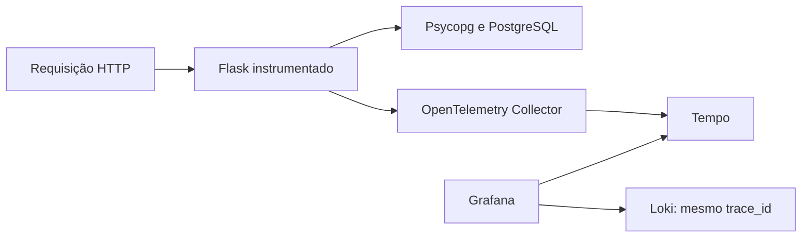

# Seguindo uma requisição

[English](README.en.md) · Português

As métricas mostram que algo mudou. Os logs ajudam a investigar. Os traces mostram as etapas de uma requisição e quanto tempo cada uma levou. Aqui a aplicação de notas ganha instrumentação OpenTelemetry para Flask e Psycopg, enviando spans ao Collector e depois ao Tempo.

A aplicação continua com duas réplicas no mesmo Kubernetes. O Grafana recebe o datasource **Notes Tempo**, com uma ligação para os logs no Loki usando o mesmo `trace_id`.



## Preparar o ambiente

Clone este projeto ao lado de [kubernetes-lab](https://github.com/tommmdl/kubernetes-lab), [monitoring-lab](https://github.com/tommmdl/monitoring-lab) e [logging-lab](https://github.com/tommmdl/logging-lab). Use Linux x86_64 ou WSL, Docker, Git, Bash e Python 3, com acesso à internet.

Se precisar começar do zero, siga os READMEs desses projetos para criar o cluster `devops-notes`, a aplicação, o Grafana e a coleta do Loki. Se eles já estão saudáveis, não reaplique os manifestos da aplicação. Exporte `KUBERNETES_LAB_DIR` se o Kubernetes lab estiver em outro caminho.

Aqui:

```bash
bash scripts/build.sh
bash scripts/lab.sh up
```

A imagem adiciona apenas as dependências de tracing e o módulo de inicialização à imagem já publicada do docker-lab. As rotas e o acesso ao banco vêm dessa base fixada por digest. As dependências Python completas ficam em `instrumentation/requirements.lock`. O SDK inicia dentro de cada worker do Gunicorn, sem `--preload`.

A imagem usa uma tag derivada dos arquivos de instrumentação e é carregada nos dois nós pelo kind. Ela **não é publicada em um registry**. `imagePullPolicy: Never` exige construir e carregar a imagem antes de aplicá-la. O script usa BuildKit e, se faltar Buildx no WSL, baixa uma versão fixa para `.local/`, verificando o checksum oficial. Isso evita um problema encontrado ao exportar imagens pelo builder legado do Docker.

## Aplicar a instrumentação

Com Argo CD, a configuração desejada está em [argocd-lab/workloads/notes-traced](https://github.com/tommmdl/argocd-lab/tree/main/workloads/notes-traced). A imagem deve corresponder a `config/app-image.json`; as variáveis OTEL seguem `application/patch.yaml`. Faça as mudanças por aquele repositório. Para selecionar essa opção, execute `bash scripts/argocd.sh apply` e aguarde **Synced / Healthy**, sem desligar self-heal. A definição da Application fica versionada em `application/argocd.yaml`; a opção básica continua disponível em `workloads/notes`.

Em um cluster descartável sem Argo CD, como o runner de CI:

```bash
bash scripts/app.sh
```

Esse script recusa o patch se encontrar a Application `notes`. Ele não deve disputar o Deployment com o Argo CD.

Depois:

```bash
python3 tests/verify.py
```

Os testes usam túneis em portas temporárias. A aplicação continua em http://localhost:8005.

## Encontrar um trace

Abra o Grafana em http://localhost:8008. Se precisar reabrir o túnel, execute `bash scripts/access.sh grafana`. O usuário e a senha continuam sendo os do monitoring-lab.

No **Explore**, selecione **Notes Tempo**. Faça uma requisição:

```bash
curl -i http://localhost:8005/notes
```

Copie o cabeçalho `X-Trace-Id` e pesquise esse ID no datasource Tempo. Você verá o span HTTP e os spans do cliente PostgreSQL, com relação de pai e filho. Esses spans medem o trabalho observado pelo driver; não instrumentam o processo do servidor PostgreSQL por dentro.

Também é possível buscar por TraceQL:

```traceql
{ resource.service.name = "notes-api" }
```

O módulo gera uma linha JSON no stdout contendo trace ID, span ID, método, rota e status. O Alloy do logging-lab coleta essa linha normalmente. A ligação de traces para logs usa os labels `app` e `namespace` e filtra o texto pelo trace ID. Não há ID de requisição transformado em label.

`/healthz` e `/readyz` ficam fora dos traces para evitar ruído das sondas. As métricas e os logs de acesso dessas rotas continuam disponíveis. Uma resposta 404 aparece como status HTTP no span; ela não é necessariamente um span com status ERROR no servidor.

## O que o teste acompanha

O teste envia um `traceparent` conhecido, verifica o ID na resposta e espera o trace real chegar ao Tempo pelo Collector. Confere o span Flask, a propagação do pai e os spans Psycopg de uma consulta SELECT. Também cria e remove somente uma nota de teste e verifica que seu título não foi copiado para o trace.

Depois consulta o trace pelo Grafana e encontra o mesmo ID nos logs do Loki. O datasource Prometheus e o datasource Loki também são conferidos. Não há envio de spans sintéticos diretamente ao Tempo para fazer o teste passar.

Veja os [resultados e limites](docs/validation.md).

**19 verificações passaram localmente e no GitHub Actions.**

## Como os dados ficam guardados

Tempo v3.1.0 roda em modo monolítico, com filesystem e PVC de 2 GiB. O Collector v0.163.1 recebe OTLP HTTP e encaminha lotes ao Tempo. As imagens oficiais estão fixadas por digest em `config/images.json`. O Collector não precisa de permissões na API do Kubernetes.

A retenção dos blocos está configurada para 24 horas; sua remoção é assíncrona e não foi validada esperando um dia inteiro. Não é uma cota de disco. O Collector tem fila em memória, sem armazenamento durável. Este lab não garante ausência de perda em falhas nem alta disponibilidade; não há Kafka, object storage, span metrics ou service graph configurados.

A amostragem usa `parentbased_always_on`: requisições sem pai são amostradas; um pai que já veio com decisão de não amostrar é respeitado. Isso é conveniente para estudo, mas não é uma política de volume para produção.

O SDK não captura corpos de requisição ou headers arbitrários. A instrumentação SQL pode incluir o texto das consultas e metadados do banco. O teste verifica um título usando parâmetros na query, não garante mascaramento de qualquer dado sensível. Não use tokens ou dados pessoais nos exercícios.

Tempo e Collector ficam como ClusterIP, sem autenticação/TLS nesta rede local. Não os exponha diretamente na internet. Para diagnóstico local do Tempo, use `bash scripts/access.sh tempo` e http://localhost:8010/ready.

## Remover com cuidado com a aplicação

Primeiro execute `bash scripts/argocd.sh restore` para selecionar os manifestos básicos no Git do argocd-lab, esperando a aplicação ficar saudável. No cluster sem Argo CD, restaure o Deployment original pelo Kubernetes lab. Depois:

```bash
bash scripts/lab.sh down
```

O script recusa a remoção enquanto encontrar a imagem instrumentada na aplicação. Depois remove apenas o datasource Notes Tempo e o namespace tracing-lab, apagando o volume e os traces. Grafana, Loki, Prometheus e os dados da aplicação ficam nos outros namespaces. `.local/` permanece fora do Git.

Configuração e testes feitos com ajuda do assistente. Referências: [instrumentação Python](https://opentelemetry.io/docs/languages/python/instrumentation/), [Psycopg](https://opentelemetry-python-contrib.readthedocs.io/en/latest/instrumentation/psycopg/psycopg.html) e [Tempo monolítico](https://grafana.com/docs/tempo/latest/set-up-for-tracing/setup-tempo/deploy/locally/linux/).

A imagem em execução agora herda as correções de segurança da API. As dependências do OpenTelemetry são instaladas em uma etapa separada do build e copiadas para a imagem final, que continua sem pip ou ensurepip. O Flask também fica fixado em 3.1.3 aqui. Veja os [relatórios completos das correções](https://github.com/tommmdl/security-lab/blob/main/docs/remediation.md); os achados restantes continuam visíveis e bloqueados pela política de segurança.

Validação das correções: 23 testes do Compose, restauração controlada de três notas da imagem original do PostgreSQL para a recompilada e 19 testes locais de tracing. A aplicação do Argo CD está Synced/Healthy e mantém o mesmo PVC. As evidências completas e as pendências estão no link acima.

As imagens corrigidas também passaram pelos [19 testes de tracing no CI](https://github.com/tommmdl/tracing-lab/actions/runs/39174296321); veja `evidence/remediation-ci-tests.json`.

Depois da análise dos críticos do PostgreSQL, a API usa uma conta SQL comum e a imagem do banco fica sem SQLite. A aplicação está saudável; passaram 24 testes de Kubernetes e 19 de tracing no CI. A [análise completa](https://github.com/tommmdl/security-lab/blob/main/docs/postgresql-critical.md) mantém os dois críticos restantes e seus limites visíveis.
